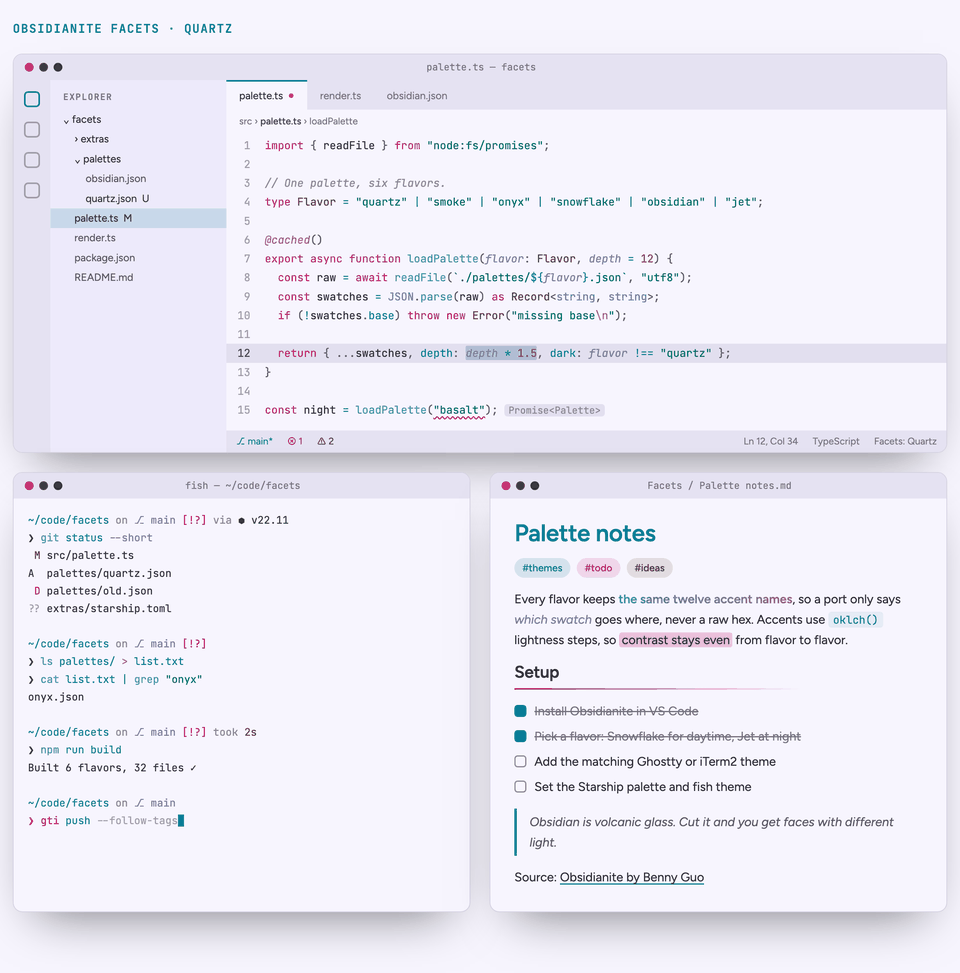
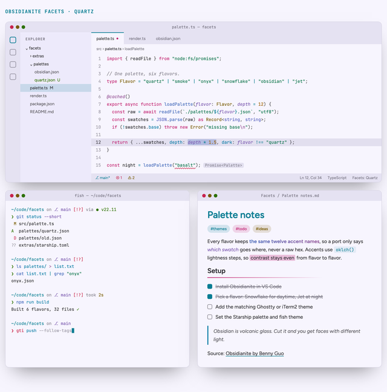
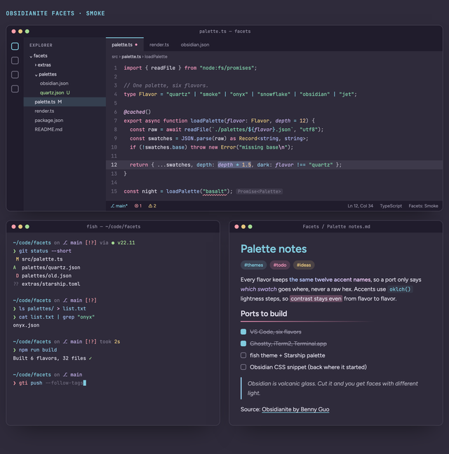
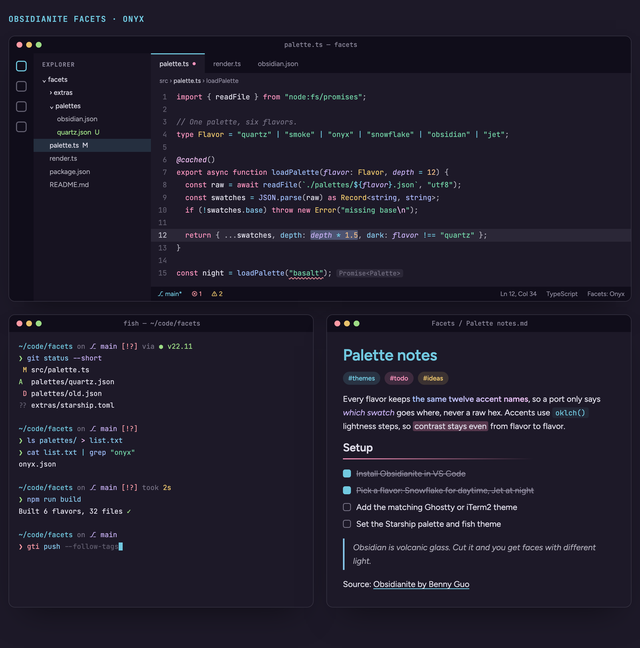
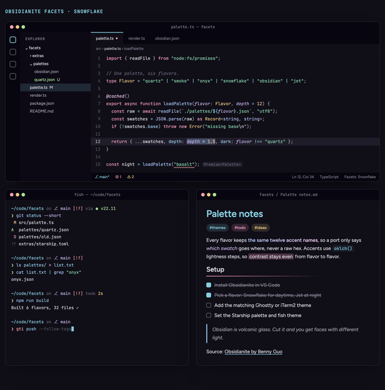
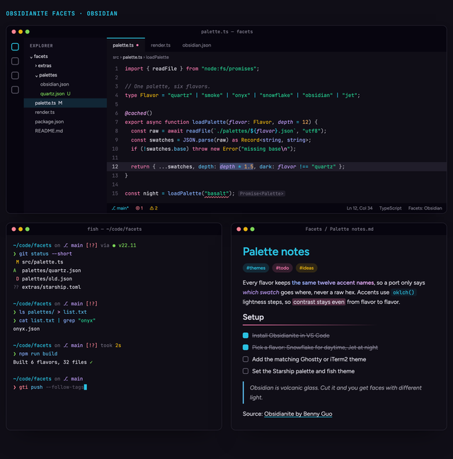
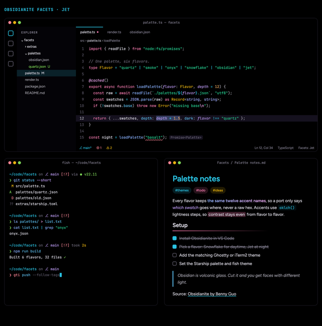

# Obsidianite VS Code Theme

A faithful port of [Obsidianite](https://github.com/bennyxguo/Obsidian-Obsidianite), the Obsidian theme by Benny Guo, to VS Code. It also includes **Obsidianite Facets**: six more flavors, from light to pure-black AMOLED, plus matching terminal themes.

<p align="center">
  
</p>

<p align="center">
  <b><a href="https://shd0w.github.io/obsidianite-vscode/">Open the interactive preview →</a></b><br>
  Switch between all six flavors and see the editor, a fish + Starship terminal, an Obsidian note, the 16 terminal colors and the full swatch guide.
</p>

<table>
<tr>
<td align="center"><a href="https://shd0w.github.io/obsidianite-vscode/#quartz"></a><br><a href="https://shd0w.github.io/obsidianite-vscode/#quartz"><b>Quartz</b></a> · light</td>
<td align="center"><a href="https://shd0w.github.io/obsidianite-vscode/#smoke"></a><br><a href="https://shd0w.github.io/obsidianite-vscode/#smoke"><b>Smoke</b></a> · soft dark</td>
<td align="center"><a href="https://shd0w.github.io/obsidianite-vscode/#onyx"></a><br><a href="https://shd0w.github.io/obsidianite-vscode/#onyx"><b>Onyx</b></a> · medium dark</td>
</tr>
<tr>
<td align="center"><a href="https://shd0w.github.io/obsidianite-vscode/#snowflake"></a><br><a href="https://shd0w.github.io/obsidianite-vscode/#snowflake"><b>Snowflake</b></a> · pastel dark</td>
<td align="center"><a href="https://shd0w.github.io/obsidianite-vscode/#obsidian"></a><br><a href="https://shd0w.github.io/obsidianite-vscode/#obsidian"><b>Obsidian</b></a> · vivid dark</td>
<td align="center"><a href="https://shd0w.github.io/obsidianite-vscode/#jet"></a><br><a href="https://shd0w.github.io/obsidianite-vscode/#jet"><b>Jet</b></a> · AMOLED</td>
</tr>
</table>

<p align="center"><sub>Click a flavor to open the interactive preview with it selected.</sub></p>

## Installation

### Option 1: Via VS Code Marketplace (Recommended)
1. Open VS Code
2. Go to Extensions (Ctrl+Shift+X)
3. Search for "Obsidianite"
4. Click Install

### Option 2: Manual Installation (Development)
1. Clone or download this repository.
2. Copy the entire repository folder to your VS Code extensions directory:
   - Windows: `%USERPROFILE%\.vscode\extensions`
   - macOS: `~/.vscode/extensions`
   - Linux: `~/.vscode/extensions`
3. Rename the folder to `shd0w.obsidianite-vscode-<version>` (for example `shd0w.obsidianite-vscode-1.1.0`)
4. Restart VS Code.
5. Select the "Obsidianite" theme from the Color Theme picker (Ctrl+K Ctrl+T).

### Option 3: Via .vsix file
1. Download the latest `.vsix` file from [Releases](https://github.com/shd0w/obsidianite-vscode/releases)
2. In VS Code: Extensions → Install from VSIX...
3. Select the downloaded file

Or from a terminal:

```bash
code --install-extension obsidianite-vscode-1.2.1.vsix
```

## Variants

- **Obsidianite**: the original deep purple-black background (`#100e17`).
- **Obsidianite AMOLED**: pure black editor and panels for OLED screens.

### Obsidianite Facets

**[See all six flavors live →](https://shd0w.github.io/obsidianite-vscode/)** (VS Code, terminal and note previews)

Six more themes built from one named palette. Pick them from the Color Theme picker by name, for example **Obsidianite Facets Snowflake**.

| Flavor | Type | Background | Look |
| --- | --- | --- | --- |
| Quartz | light | `#f7f5fe` | Pale lavender, deepened accents |
| Smoke | dark | `#2f2b3b` | Lifted purple-grey, soft pastels |
| Onyx | dark | `#1d1928` | Deeper base, pastel accents |
| Snowflake | dark | `#100e17` | Obsidianite's background with pastel accents |
| Obsidian | dark | `#100e17` | Obsidianite's background with vivid accents |
| Jet | AMOLED | `#000000` | Vivid accents on pure black |

Every flavor uses the same twelve accent names (garnet, tourmaline, kunzite, amethyst, iolite, sapphire, topaz, aquamarine, jade, peridot, citrine, carnelian). Each one has the same job in every flavor:

| Role | Swatch |
| --- | --- |
| Keywords | tourmaline |
| Functions | sapphire |
| Strings | jade |
| Numbers, constants | carnelian |
| Types, classes | citrine |
| Parameters | amethyst (italic) |
| Properties, keys | topaz |
| Operators, cursor, accent | aquamarine |
| Built-ins | iolite |
| Decorators, escapes | kunzite |
| Errors / additions | garnet / peridot |

## Features

- Colors taken from the original Obsidianite CSS: cyan `#0fb6d6`, pink `#f4569d`, blue `#7aa2f7` and purple `#bb9af7`.
- Semantic highlighting, so variables, parameters, properties, types and deprecated symbols stay consistent in TypeScript, Python, Rust, Go and others.
- Markdown styled like Obsidianite notes: cyan H1, pale headings, blue bold, cyan inline code and pink bullets.
- Errors are pink and warnings are yellow, so you can tell them apart at a glance.
- Bracket-pair colors, find and selection highlights, sticky scroll, inlay hints and the minimap all use the theme.
- The integrated terminal uses the same 16-color palette as the terminal themes below.

## Terminal themes

The same palette is available for your terminal in [`extras/`](extras):

| Terminal | File | How to install |
| --- | --- | --- |
| Ghostty | `extras/ghostty/Obsidianite` | Copy to `~/.config/ghostty/themes/`, then add `theme = Obsidianite` to your Ghostty config. |
| iTerm2 | `extras/iterm2/Obsidianite.itermcolors` | Double-click the file, or go to Settings → Profiles → Colors → Color Presets → Import. Then pick **Obsidianite** from the same menu. |
| macOS Terminal | `extras/terminal-app/Obsidianite.terminal` | Double-click the file, or go to Settings → Profiles → ⋯ → Import. Then click **Default** to keep it. |

Shell prompts that use the standard color names (fish, Starship, zsh, etc.) pick up the palette automatically.

### Facets terminal and shell themes

Every Facets flavor ships for each tool in [`extras/facets/`](extras/facets):

| Tool | Folder | How to install |
| --- | --- | --- |
| Ghostty | `ghostty/` | Copy the file to `~/.config/ghostty/themes/`, then set `theme = Obsidianite Facets Obsidian` (or another flavor). |
| iTerm2 | `iterm2/` | Double-click the `.itermcolors` file, then pick it under Settings → Profiles → Colors → Color Presets. |
| macOS Terminal | `terminal-app/` | Double-click the `.terminal` file, then click **Default** in Settings → Profiles to keep it. |
| fish | `fish/` | Copy the `.theme` file to `~/.config/fish/themes/`, then run `fish_config theme save "Obsidianite Facets Obsidian"`. |
| Starship | `starship/palettes.toml` | Paste a palette block into `~/.config/starship.toml` and set `palette = "obsidianite_facets_obsidian"`. Then you can use swatch names in styles, e.g. `style = "bold aquamarine"`. |

## Building

The Facets themes and every terminal port are generated from [`palettes/facets.json`](palettes/facets.json). To change a color, edit it there and rebuild:

```bash
npm run build
```

`npm run package` builds and creates the `.vsix`. Terminal.app profiles can only be generated on macOS. The original Obsidianite and Obsidianite AMOLED themes are edited by hand in `themes/`.

## Changelog

See [CHANGELOG.md](CHANGELOG.md).

## Credits

This is an independent, unofficial port. Thanks to:

- **[Obsidianite](https://github.com/bennyxguo/Obsidian-Obsidianite)** by **Benny Guo** (MIT): the Obsidian theme this extension ports. Its backgrounds, cyan and pink accents, and note styling are the base of every theme here.
- **[Dracula](https://draculatheme.com)** (MIT): the syntax colors Obsidianite uses in its code blocks, which the original themes here keep.
- **[Catppuccin](https://github.com/catppuccin/catppuccin)** (MIT): the inspiration for how Obsidianite Facets is organized: one palette, several flavors, named swatches and a style guide. Facets doesn't use Catppuccin's colors, names or code.

Not affiliated with Obsidian, Obsidianite, Dracula or Catppuccin. See [CREDITS.md](CREDITS.md) for what comes from where, and the full license texts.
